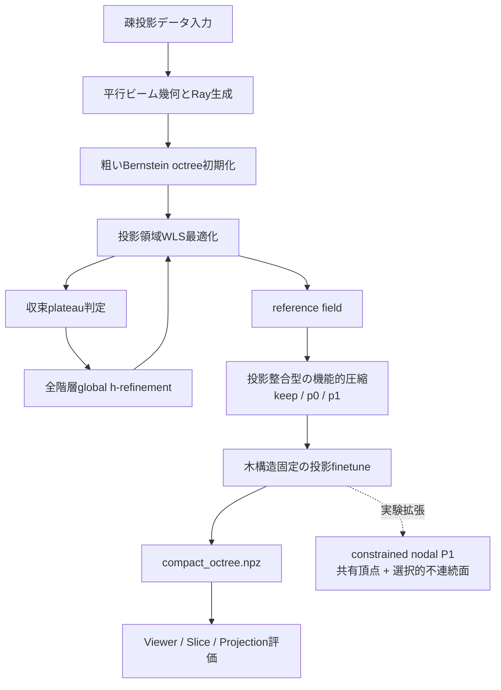

# 適応型投影領域CT再構成フレームワーク

## 対象データ

R2 形式の平行ビームCTデータを対象とする。

入力はスキャナ幾何、投影角度、疎な投影画像で構成される。正解ボリュームが存在する場合でも、主パイプラインでは学習や木構造の選択には使用せず、最終評価にのみ使用する。

## 最新Pipelineの全体フロー



## 1. 平行ビーム幾何とRay生成

各投影角度と検出器画素から、再構成領域を通過するrayを生成する。

学習時は全投影を毎回展開するのではなく、投影画素からrayをランダムにサンプリングする。これにより、高解像度データでもGPUメモリ使用量を制御しながら最適化できる。

octreeに対するray-cell交差と線積分はCUDAで実行する。主経路ではセル内のBernstein関数を正確に積分し、均一なサンプリング点へ一度展開する処理を必要としない。

## 3. Packed Bernstein Octree表現

再構成場は、各leafが局所Bernstein多項式を持つ疎なoctreeとして表現する。

| 要素 | 役割 |
| --- | --- |
| packed hierarchy | leafと内部nodeを連続配列で保持し、CUDA traversalとcompact exportに使用 |
| refinement | 1個のleafを8個の子leafへ分割し、必要な領域だけ空間解像度を上げる |
| p0 leaf | セル内を一定値で表す。平坦領域を低コストで保持する |
| p1 leaf | 8個の係数を持つ三線形関数。滑らかな変化を粗いセルのまま表す |
| de Casteljau subdivision | 分割前後で表現関数を変えないfunction-preserving splitに使用 |

主パイプラインの最初の再構成はp0 leafから開始する。p1は主に後段の機能的圧縮で導入される。

## 4. 投影領域での直接最適化

モデルから計算した投影値と測定投影を比較し、係数を直接更新する。

基本損失は weighted least squares である。

```text
prediction = exact_project(BernsteinOctree, rays)
loss       = mean(weight * (prediction - measured_projection)^2)
```

この段階ではdense volumeを生成してから比較するのではなく、octree表現から測定領域へ直接forward projectionする。

投影重みは `uniform / inverse / target_power / dynamic_range_balanced` などを設定できる。投影微分損失や係数面の連続性損失も実装されているが、主検証runでは投影整合性を明確にするため無効化している。

## 5. 収束判定とGlobal h-refinement

投影損失のEMAを監視し、改善がplateauに達した時点で木構造を更新する。

refinementでは階層ごとのquotaを先に決めず、分割可能な全leafを一つのglobal queueへ入れる。各候補は、隣接面の係数jump、セルスケール、追加されるpacked byteから評価する。

```text
score = scale-aware face-jump indicator / added packed bytes
```

高いscoreを持つ候補から、各refinement roundの追加byte budget内で分割する。分割はfunction-preservingであるため、構造更新直後に再構成関数が不連続に変化することを避けられる。

標準selectorは以下を必須条件としない。

- attenuation threshold
- support mask
- minimum active resolution
- 階層別quota
- forced material coverage
- test viewによる構造選択

固定したdecision rayでplateauを測る機能もあるが、現在は安定性診断用であり。

## 6. reference fieldの作成

複数回の最適化とglobal refinementを繰り返し、空間詳細をleaf分割だけで表したreference fieldを作る。

industrial-detail entry pointは、外部checkpointを参照場として受け取らない。指定された疎投影からreferenceを毎回再構成するため、入力投影、設定、最終compact modelの対応関係を追跡できる。

このreferenceは高精細な中間表現であり、そのまま配布する最終モデルではない。後段の圧縮に対して、残すべき局所構造と滑らかに近似できる領域を与える。

## 7. 投影整合型の機能的圧縮

reference treeを下位階層から評価し、各内部部分木に対して以下の3候補を作る。

| Action | 内容 | 主な対象 |
| --- | --- | --- |
| `keep` | 現在の部分木をそのまま保持 | 境界、微細欠陥、単純関数で置換しにくい領域 |
| `p0` | 部分木全体を一定値leafへ置換 | ほぼ均一な領域 |
| `p1` | 部分木全体を三線形leafへ置換 | 緩やかな濃度勾配を持つ領域 |

候補の歪みは、候補へ置換した場合のtraining projection residualの変化から計算する。各候補の歪みと必要byte数を用い、tree dynamic programmingによりglobal byte budget内の組合せを選ぶ。

このため、圧縮はファイルを後処理で小さくするだけではなく、投影整合性を基準に空間表現そのものを選び直す処理となる。

## 8. 木構造固定のProjection Finetune

圧縮後はleaf構造と `p0 / p1` の割当てを固定し、全係数を疎投影に対して再最適化する。

圧縮候補は局所的・加法的な近似で評価されるため、複数候補を同時に採用した後にはray全体で小さな相互作用が残る。fixed-topology finetuneは、この全体誤差を実測投影に戻して補正する役割を持つ。

この段階ではleafの追加・削除を行わないため、最終保存容量を変えずに投影整合性を回復できる。

## 9. Compact exportとViewer

最終モデルはpacked topologyと量子化係数を `.npz` に保存する。

| 出力 | 内容 |
| --- | --- |
| `checkpoint.pt` | 学習状態、設定、完全なframework metadataを含む研究用checkpoint |
| `training_report.json` | 学習履歴、refinement event、評価条件、実行時間 |
| `compression_report.json` | `keep / p0 / p1` の選択数、byte数、finetune、投影評価 |
| `compact_octree.npz` | 表示・配布向けのpacked hierarchyと量子化係数 |

ViewerはPython HTTP backendとVite + TypeScript + Three.js frontendで構成される。

主な表示機能は以下である。

- leafを実セルサイズで表示し、level・減衰係数・cell sizeで着色
- axial / coronal / sagittal断面と正解断面の比較
- モデル投影と保存済み投影の比較
- checkpointおよびcompact `.npz` のruntime切替
- YAMLや正解データがない場合のmodel-only表示

高解像度断面は要求された2D planeだけをsampleするため、元解像度のdense volume全体を事前展開しない。

## 10. Constrained Nodal P1拡張（実験機能）

現在、p1 leafの係数を全leafで独立に持つ方式に加えて、幾何学的に同じ頂点を共有するconstrained nodal P1表現を実装している。

処理内容は以下の通りである。

```text
balanced p1 tree
-> shared geometric vertices
-> hanging-node constraints
-> projection-domain private-interface selection
-> fixed-topology finetune
-> compact nodal export
```

2:1でbalancedな木では、細かいセル側のedge midpointやface centreを独立変数にせず、粗いQ1セルの頂点から補間する。一方、材料境界やcrackのように連続性を強制すべきでない面はprivate faceとして切り離せる。

この拡張は、滑らかな領域では共有頂点によって自由度を減らし、不連続面では片側値を保持することを目的としている。変換後はtopologyを固定し、既存のexact projectorをそのまま使用する。

現時点では実験評価中であり、標準Pipeline v5の必須段階ではない。

## 11. 現在の確認結果

256-viewのローカル検証runで確認した代表値は以下である。

| 項目 | 結果 |
| --- | ---: |
| training views / test views | 256 / 4 |
| reference projection PSNR | 42.7531 dB |
| reference projection MAE | 0.001924 |
| Pipeline v5 finetune後 projection PSNR | 44.0745 dB |
| Pipeline v5 finetune後 projection MAE | 0.001671 |
| 最終leaf数 | 1,742,112 |
| p0 / p1 leaf数 | 1,464,047 / 278,065 |
| compact file size | 9,369,481 bytes（約8.94 MiB） |
| 15代表断面の平均PSNR | 31.2063 dB |
| 15代表断面の平均MAE | 0.01197 |
| 高gradient領域PSNR | 19.6463 dB |

投影PSNRだけでは正確な3D再構成を保証しない。そのため、最終評価では投影誤差に加えて、断面PSNR/MAE、高gradient領域、boundary quality、保存容量、実行時間を同じ条件で報告する。

## 12. 現在の適用範囲

本フレームワークは、疎view条件で高周波構造を保持しながら、再構成精度と保存容量を同時に制御するための研究prototypeである。

現在確認済みの主経路は、R2形式の平行ビームCT、CUDA環境、projection-domain Bernstein octree、Pipeline v5 compression、compact viewerである。

実スキャナに対する中心回転ずれ、検出器shift、角度offsetなどの自己校正は、projection residual診断の前処理として追加可能だが、現在の標準パイプラインにはまだ含めていない。

本実装は医療機器ではなく、診断・治療目的には使用しない。
