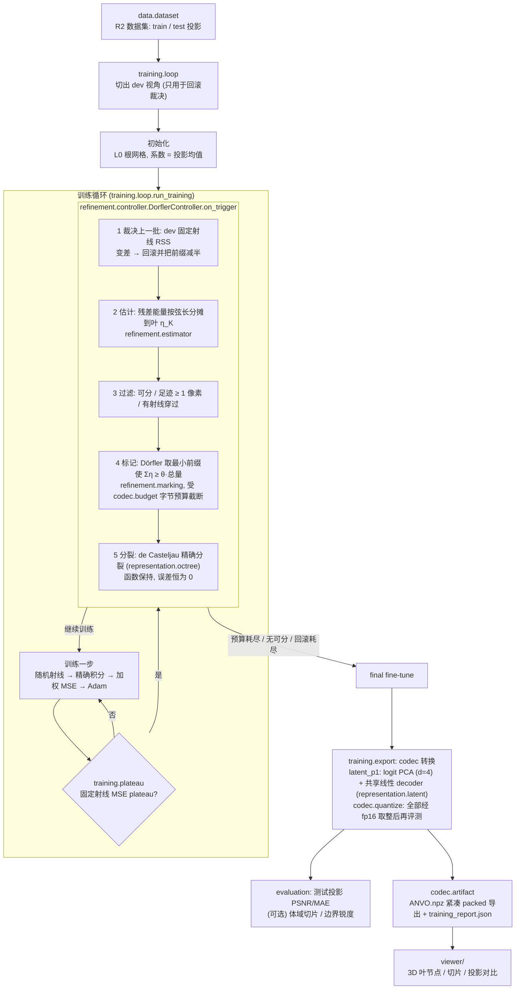

# 代码框架

投影驱动的自适应八叉树 CT 重建：从多视角平行束投影出发，不用 FDK、不用参考体，
由投影残差自己决定哪里细分，并在部署字节预算内收敛。

## 目录

```
adaptive_ct/
  core/            config.py  geometry.py  loss.py  projector.py
  data/            dataset.py  splits.py  rays.py
  representation/  octree.py  latent.py  factory.py  snapshot.py
  evaluation/      metrics.py  render.py  volume.py
  codec/           budget.py  quantize.py  finetune.py  artifact.py
  refinement/      estimator.py  marking.py  controller.py
  training/        loop.py  plateau.py  export.py  validate.py  __main__.py
  viewer/          server.py + web/ (Three.js)
native/            bernstein_octree.cu  projector.cu  ext.cpp
configs/stage7/    p1.yaml  p0.yaml  p0_longft.yaml  p1_nogate.yaml
tests/             与 adaptive_ct/ 镜像
```

## 分层与依赖方向

只允许自上而下引用，不允许反向或循环：

```
core ← data ← representation ← evaluation ← codec ← refinement ← training
                                                                    ▲
                                          viewer ───────────────────┘ (只读, 复用下层)
```

| 层 | 模块 | 职责 |
|---|---|---|
| `core` | `config` / `geometry` / `loss` / `projector` | yaml 继承加载；平行束射线；投影权重与加权 MSE；CUDA 扩展封装 |
| `data` | `dataset` / `splits` / `rays` | R2 数据集；train/dev 视角切分；固定射线集、随机射线采样、`fixed_rss` |
| `representation` | `octree` / `latent` / `factory` / `snapshot` | `BernsteinOctree`（packed 树、P0/P1 叶、精确积分、精确分裂）；`LatentP1Octree`（PCA codec 模型）；模型工厂；拓扑与参数快照/恢复 |
| `evaluation` | `metrics` / `render` / `volume` | PSNR/MAE；按视角渲染投影；有 GT 体时的事后评测 |
| `codec` | `budget` / `quantize` / `finetune` / `artifact` | 部署字节的确定性公式；fp16 取整；codec 微调；紧凑导出与加载 |
| `refinement` | `estimator` / `marking` / `controller` | 残差能量估计与可分性过滤；Dörfler 标记；回滚控制器 |
| `training` | `loop` / `plateau` / `export` / `validate` | 训练循环与报告；plateau 触发；codec 转换与切片预览；配置检查 |

## 数据流



## 协议与约束

- 数据划分：train 240 / dev 16 / test 4。dev 只用于回滚裁决和诊断；test 只在训练结束后评测。
- 不使用 FDK、参考体或 GT 体做初始化、拓扑或打分；GT 体只在训练后加载做评测。
- 字节预算按最终 codec 的确定性公式计算（不做熵编码），导出文件的 `raw_payload_bytes`
  会多一个固定约 4 KiB 的元数据字符串。
- 细分唯一的动作是 h-split；每次分裂函数保持，所以批量分裂本身不会改变投影。

## 配置（`configs/stage7/`）

| 配置 | 用途 |
|---|---|
| `p1.yaml` | 主线：P1 叶 + latent d=4 codec，预算 8 MiB |
| `p0.yaml` | 对照：P0 叶，同估计器同预算，plateau 后只微调 2000 步 |
| `p0_longft.yaml` | 计算量匹配的 P0 对照（多微调到与 P1 相近的迭代数） |
| `p1_nogate.yaml` | 消融：去掉 dev 回滚 |

## 运行

环境：项目内 `.venv`（Python 3.10 + torch 2.11.0+cu130，匹配本机 CUDA 13.0 工具链，可重编原生扩展）。

```powershell
.venv\Scripts\python.exe -m adaptive_ct.training --config configs\stage7\p1.yaml
scripts\test.ps1        # .venv\Scripts\python.exe -m unittest discover -s tests -t .
```

## 已知缺口

- 噪声底估计：空气分位数方差（约 1.7e-4）比实际残差 MSE 大 2–4 倍，目前配置里
  `noise_variance_scale: 0`，"误差降到噪声底就停"这条停止条件暂不生效。
- 尚无切片/体域指标脚本和与 NeAT / 3DGS 的字节公平比较。
