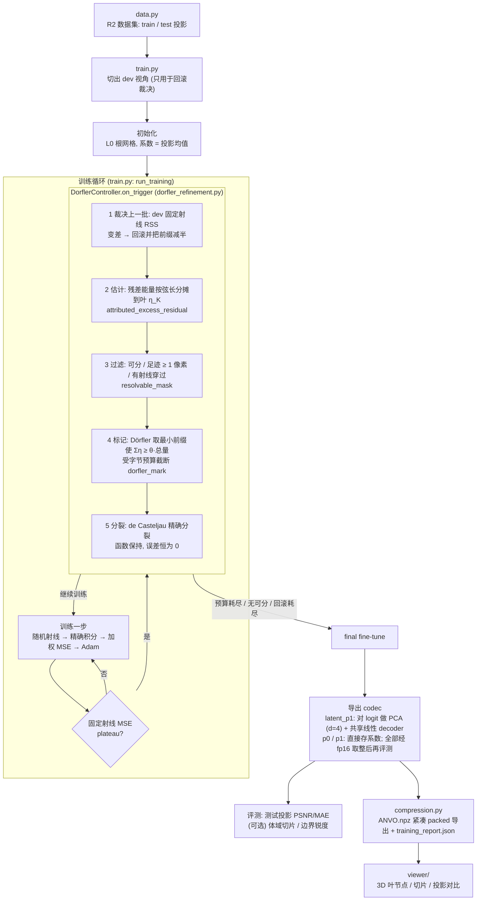

# 代码框架

投影驱动的自适应八叉树 CT 重建：从多视角平行束投影出发，不用 FDK、不用参考体，
由投影残差自己决定哪里细分，并在部署字节预算内收敛。

## 数据流



## 模块依赖

```
                    train.py  (入口: 训练循环 / 导出 / 报告)
   ┌──────────┬────────┬────┴─────┬──────────────┬─────────────┬────────────┐
   │          │        │          │              │             │            │
config.py  data.py  model.py   dorfler_refinement.py        compression.py  volume_metrics.py
 (yaml +   (数据集    (build_   (估计/标记/回滚/codec 字节      (紧凑导出/加载)   (GT 体评测,
 extends)  与视角)    model)     /量化/微调)                         │           仅事后评测)
                      │   │      │      │      │                  │              │
                      │   │      │      │      └─ projection_domain.py            │
                      │   │      │      │          (投影权重 / 加权损失 / 视角切分)  │
                      │   │      │      └─ decision_rays.py (固定射线集 + fixed_rss)│
                      │   │      └──────────── geometry.py (射线 / 平行束几何)      │
                      │   │                                                       │
              latent_p1.py  bernstein.py ◄────────────────────────────────────────┘
        (LatentP1Octree:    (BernsteinOctree: packed 八叉树 + P0/P1 Bernstein 叶
         PCA codec 模型)      精确射线积分, 分裂/合并/升阶)
                                  │
                              backend.py ──► native/ (CUDA: bernstein_octree.cu, projector.cu)
   render.py (按视角渲染投影)   metrics.py (PSNR / MAE)
```

## 模块职责

| 模块 | 行数 | 职责 |
|---|---:|---|
| `train.py` | 684 | 入口。配置校验 → 数据 → 模型 → 训练循环 → plateau 触发 Dörfler → codec → 评测 → 导出 → 报告 |
| `dorfler_refinement.py` | 481 | 细分核心：估计器、可分性过滤、Dörfler 标记、字节模型、回滚控制器、codec 量化与微调 |
| `bernstein.py` | 1276 | `BernsteinOctree`：packed 层级拓扑、P0/P1 叶函数、非负 softplus 参数化、精确积分、`split_leaves_batch` |
| `latent_p1.py` | 243 | `LatentP1Octree`：每叶 latent + 共享线性 decoder；`from_bernstein` 做 PCA 压缩 |
| `compression.py` | 566 | 紧凑 packed 导出与加载（含 latent schema） |
| `decision_rays.py` | 88 | 固定射线集：plateau 标尺和裁决用，保证前后可比 |
| `projection_domain.py` | 108 | 投影权重、加权投影损失、train/dev 视角切分 |
| `geometry.py` | 135 | 平行束几何、随机训练射线 |
| `backend.py` | 262 | CUDA 扩展封装（精确 Bernstein 积分、稠密投影） |
| `volume_metrics.py` | 139 | 有 GT 体时的事后评测，不进入训练 |
| `data.py` / `config.py` / `model.py` / `render.py` / `metrics.py` | 26–82 | 数据集加载 / yaml 继承 / 模型工厂 / 渲染 / 指标 |
| `viewer/` | — | HTTP 服务 + Three.js 前端，查看叶节点、切片与投影 |

## 协议与约束

- 数据划分：train 240 / dev 16 / test 4。dev 只用于回滚裁决和诊断；test 只在训练结束后评测。
- 不使用 FDK、参考体或 GT 体做初始化、拓扑或打分；GT 体只在训练后加载做评测。
- 字节预算按最终 codec 的确定性公式计算（不做熵编码），导出文件的 `raw_payload_bytes`
  会多一个固定约 4 KiB 的元数据字符串。
- 细分唯一的动作是 h-split；每次分裂函数保持，所以批量分裂本身不会改变投影。

## 配置（`configs/research/`）

| 配置 | 用途 |
|---|---|
| `stage7_dorfler_p1_256v.yaml` | 主线：P1 叶 + latent d=4 codec，预算 8 MiB |
| `stage7_dorfler_p0_256v.yaml` | 对照：P0 叶，同估计器同预算，plateau 后只微调 2000 步 |
| `stage7_dorfler_p0_longft_256v.yaml` | 计算量匹配的 P0 对照（多微调到与 P1 相近的迭代数） |
| `stage7_dorfler_p1_nogate_256v.yaml` | 消融：去掉 dev 回滚 |

## 运行

```powershell
py -3.10 -m adaptive_ct.train --config configs\research\stage7_dorfler_p1_256v.yaml
py -3.10 -m unittest discover -s tests
```

## 已知缺口

- 噪声底估计：空气分位数方差（约 1.7e-4）比实际残差 MSE 大 2–4 倍，目前配置里
  `noise_variance_scale: 0`，"误差降到噪声底就停"这条停止条件暂不生效。
- `native/dynamic_voxel.cu` 及其绑定是旧稠密体素模型留下的，Python 端已不再使用，
  下次重编扩展时可一并删除。
- 尚无切片/体域指标脚本和与 NeAT / 3DGS 的字节公平比较。
